# PocketMaint — Sistema de Ordens de Serviço Industrial & Terminal Portátil

<p align="left">
  
  
  
  
  
  
  
</p>

> 📌 **Status do Repositório — Backend e Firmware Integrados e Homologados**  
> **Versão:** `1.2.0` | **Tag de Release:** `v1.2.0-full-system`  
> Este repositório contém a implementação completa do **PocketMaint**, integrando a API RESTful em Spring Boot (Java 17 LTS) com o microterminal portátil industrial (**M5Stack CardPuter ADV / ESP32-S3**).
> 
> 📑 **Documentos Centrais do Projeto:**
> - 📘 **[Especificação Técnica Completa (SPECIFICATION.md)](docs/SPECIFICATION.md)**
> - 📋 **[Relatório e Checklist de Homologação de Hardware](docs/hardware-acceptance-checklist.md)**
> - 📄 **[Contrato OpenAPI v3 em YAML](docs/api/openapi-v1.yaml)**

<p align="center">
  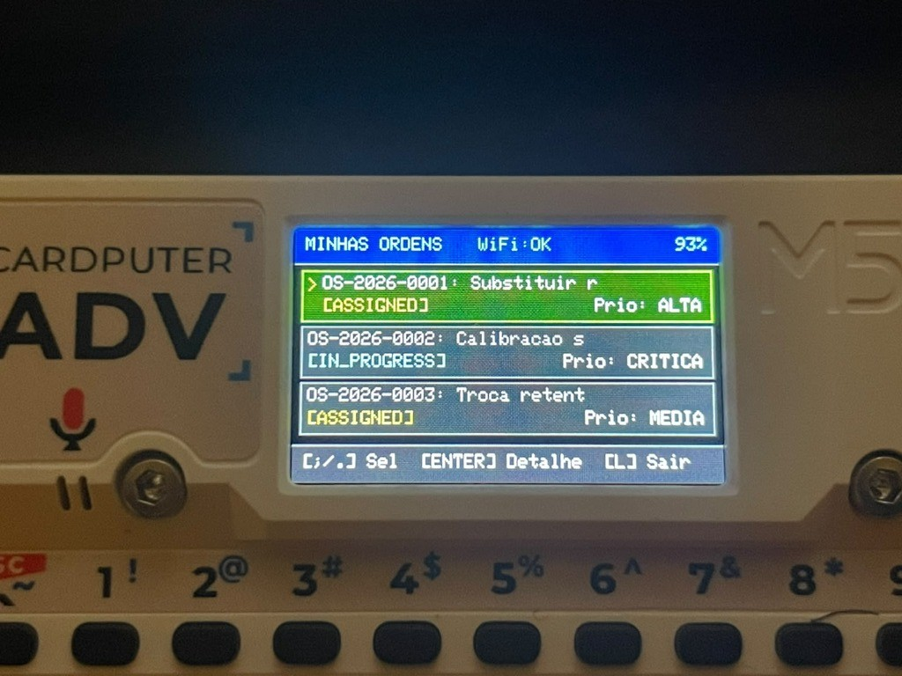
  &nbsp;
  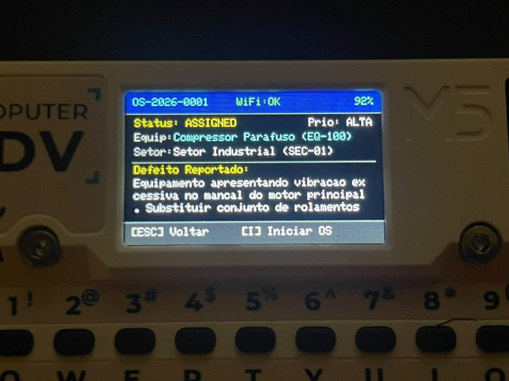
</p>
<p align="center">
  <em>M5Stack CardPuter ADV executando o PocketMaint: Fila de ordens com rolagem e cursor (esquerda) e tela de atendimento com defeito reportado (direita).</em>
</p>

---

## 1. Visão Geral e Arquitetura

O **PocketMaint** é um sistema transacional com autoridade centralizada para abertura, despacho, atendimento de campo e auditoria de Ordens de Serviço (OS) industriais.

### 1.1 Diagrama de Arquitetura Fim a Fim (Hardware & Software)

```
┌─────────────────────────────────┐
│     M5Stack CardPuter ADV       │
│  (ESP32-S3 @ 240MHz, FreeRTOS)  │
│  Display ST7789V2 240x135 px    │
│  Teclado 56 Teclas / ADC Bat    │
└────────────────┬────────────────┘
                 │
                 │ 802.11 b/g/n (Wi-Fi 2.4 GHz)
                 │ HTTP/1.1 RESTful JSON
                 │ Authorization: Bearer <JWT>
                 │ Idempotency-Key: <UUID>
                 ▼
┌────────────────────────────────────────────────────────┐
│             PocketMaint Backend API                    │
│      (Spring Boot 3.3.x / Java 17 LTS / Tomcat)        │
│                                                        │
│  ┌──────────────────┐    ┌──────────────────────────┐  │
│  │ Security Filter  │    │  Global Exception (9457) │  │
│  │ (Stateless JWT)  │    │  (AUTH_TOKEN_EXPIRED)    │  │
│  └────────┬─────────┘    └────────────┬─────────────┘  │
│           │                           │                │
│  ┌────────▼───────────────────────────▼─────────────┐  │
│  │  REST Controllers (EP-001 a EP-010 / OpenAPI v3) │  │
│  └────────────────────┬─────────────────────────────┘  │
│                       │                                │
│  ┌────────────────────▼─────────────────────────────┐  │
│  │  Service Layer & State Machine (BR-001 a BR-009) │  │
│  └────────────────────┬─────────────────────────────┘  │
│                       │                                │
│  ┌────────────────────▼─────────────────────────────┐  │
│  │  Spring Data JPA / Hibernate ORM (MySQL Dialect) │  │
│  └────────────────────┬─────────────────────────────┘  │
└───────────────────────┼────────────────────────────────┘
                        │
                        │ JDBC (Porta 3306)
                        ▼
       ┌─────────────────────────────────┐
       │     MySQL 8.0 Database          │
       │  (Flyway Migrations V1 e V2)    │
       │  ACID Transactions & InnoDB     │
       └─────────────────────────────────┘
```

### 1.2 Arquitetura Monólito Modular do Backend

```
src/main/java/br/com/pocketmaint/
├── config/              # Configurações do OpenAPI/Swagger UI e Beans de infraestrutura
├── controller/          # Endpoints RESTful versionados (/api/v1/...) com anotações OpenAPI
├── dto/                 # Contratos de entrada e saída imutáveis (Records nativos do Java 17)
├── exception/           # Manipulador global RFC 9457 e exceções semânticas de negócio
├── model/               # Entidades JPA ricas, encapsulando transições da máquina de estados
│   └── enums/           # Enums tipados (OrderStatus, Role, Priority, AuditEventType, OriginChannel)
├── repository/          # Interfaces Spring Data JPA para persistência otimizada
├── security/            # Spring Security, filtros JWT stateless, RBAC e validação anti-IDOR
└── service/             # Orquestração transacional, regras de negócio e serviço de auditoria
```

---

## 2. Contexto de Origem, Trajetória e Engenharia Assistida por IA

### 2.1 A Origem: Da Sala de Aula ao Chão de Fábrica
A versão baseline e o embrião deste projeto nasceram em sala de aula durante o meu **Curso Técnico em Desenvolvimento de Sistemas**, logo nas primeiras semanas de contato com o ecossistema **Java e Spring Boot**. O exercício acadêmico original propunha uma estrutura básica para simulação de abertura de ordens de serviço.

A decisão de transformar esse projeto acadêmico em uma solução industrial de ponta a ponta integrada a um microterminal físico (**M5Stack CardPuter ADV**) foi uma iniciativa e experimentação **100% autoral**. 

### 2.2 Primeiro Contato com Embarcados e Pair Programming com IA
Eu nunca havia programado para microcontroladores ou sistemas embarcados antes deste projeto. Para superar essa barreira técnica e transpor o abismo entre o software corporativo e o hardware físico, utilizei inteligência artificial como um **"Tech Lead / Pair Programmer Virtual"** — especificamente o **Google Antigravity**.

A condução do desenvolvimento não foi passiva: estabelecemos um **ciclo rigoroso de engenharia dividido em 13 Milestones incrementais**, onde cada entrega de firmware e backend foi auditada, compilada e **validada fisicamente em bancada real** com o CardPuter conectado via USB e Wi-Fi antes de avançar para o próximo passo.

### 2.3 Transparência Técnica: Base Consolidada vs. Conhecimentos Acelerados

* **O que faz parte da minha base de compreensão (Sala de Aula & Prática):**
  * Fundamentos do Spring Boot, arquitetura em camadas (`controller`, `service`, `repository`, `dto`) e anotações do ecossistema Spring MVC.
  * Modelagem relacional no MySQL, chaves estrangeiras, transições lógicas de entidades e consultas Spring Data JPA.
  * Princípios de orientação a objetos, interfaces, modularização e validações declarativas (`Bean Validation`).

* **O que foi acelerado e aprofundado com auxílio de IA (Em estudo contínuo na grade):**
  * **Sistemas Embarcados & C++ no ESP32-S3:** Gestão de periféricos no PlatformIO, resolução de conflitos de bibliotecas globais no Arduino Core 3.x, particionamento customizado de memória Flash (`huge_app.csv`), eliminação de flickering visual via **Double-Buffering em RAM** (`M5Canvas`) e estabilização de leitura ADC de bateria por filtro passa-baixa.
  * **Docker & Docker Compose:** Criação do ambiente containerizado reprodutível para o banco de dados MySQL 8.0, assunto que ainda não havia sido apresentado na grade curricular do curso técnico.
  * **Testes Automatizados & Blindagem de Domínio:** Construção de mais de 30 testes unitários (`OrderStateMachineUnitTest`) e de integração com `MockMvc` (`OrderSecurityIntegrationTest`), validando isolamento de fila de técnico (AC-001) e proteção anti-IDOR/BOLA (BR-003).
  * **Padrões Corporativos:** Implementação do padrão RFC 9457 (*Problem Details*) com captura semântica de tokens JWT expirados (`AUTH_TOKEN_EXPIRED`), suporte ao cabeçalho `Idempotency-Key` e auditoria transacional atômica.

---

## 3. Máquina de Estados e Regras de Negócio

O ciclo de vida de uma Ordem de Serviço obedece a uma máquina de estados estrita com 5 estados formais:

```
        ┌────────────────────────────────────────────────────────┐
        │                                                        │ (BR-006: Cancelar)
        ▼                                                        │
    [ OPEN ] ────(BR-002: Atribuir)───► [ ASSIGNED ] ───────────┤
                                             │                   │
                                   (BR-003: Iniciar)             │
                                             │                   │
                                             ▼                   │
                                     [ IN_PROGRESS ] ────────────┤
                                             │                   │
                                   (BR-004: Concluir)            │
                                             │                   │
                                             ▼                   ▼
                                       [ COMPLETED ]       [ CANCELLED ]
                                    (Estado Terminal)    (Estado Terminal)
```

### Regras de Negócio Canônicas (BR-001 a BR-009):
- **BR-001 — Vínculo Obrigatório com Equipamento Ativo:** Toda OS deve estar associada a um equipamento ativo cadastrado.
- **BR-002 — Atribuição Exclusiva a Técnicos Ativos:** Apenas usuários ativos com o papel `TECHNICIAN` podem ser atribuídos a uma OS.
- **BR-003 — Autorização Anti-IDOR de Atendimento:** O técnico autenticado só pode visualizar detalhes completos, iniciar ou concluir ordens designadas especificamente ao seu ID.
- **BR-004 — Proibição de Conclusão Direta:** Uma OS não pode saltar de `ASSIGNED` diretamente para `COMPLETED`; a transição intermediária por `IN_PROGRESS` é obrigatória.
- **BR-005 — Justificativa Técnica Obrigatória na Conclusão:** O fechamento da ordem exige descrição técnica da solução com extensão entre 10 e 500 caracteres.
- **BR-006 — Proibição de Cancelamento em Estados Terminais:** Ordens em `COMPLETED` ou `CANCELLED` não podem ser canceladas. O cancelamento exige justificativa entre 10 e 300 caracteres.
- **BR-007 — Idempotência de Transições:** Repetições de requisições de início ou encerramento com a mesma chave/estado retornam `200 OK` sem gerar erros nem duplicar registros de auditoria.
- **BR-008 — Auditoria Transacional Obrigatória:** Toda transição de estado gera registro imutável em `audit_events` na mesma transação atômica (`@Transactional`).
- **BR-009 — Inativação em vez de Exclusão Física (Soft Delete):** Setores e Equipamentos nunca sofrem `DELETE` físico se houver registros vinculados; recebem marcação `active = false`.

---

## 4. Roteiro Incremental de Milestones (Histórico de Entrega)

Todas as metas estabelecidas no plano de modernização e no ciclo de blindagem foram integralmente cumpridas:

### 4.1 Fase 1 — Construção da API e Infraestrutura
- **[x] Milestone 0:** Publicação do baseline legado acadêmico e documentação inicial. *(Tag: `v0.0.0-baseline-legado`)*
- **[x] Milestone 1:** Dependências Maven (`pom.xml`), configuração de banco e migrações Flyway (`V1__schema`, `V2__seed`).
- **[x] Milestone 2:** Entidades de domínio completas (`User`, `ServiceOrder`, `OrderAssignment`, `AuditEvent`), Enums e Repositórios JPA.
- **[x] Milestone 3:** Máquina de estados (5 estados), regras de negócio (`BR-001` a `BR-008`) e `AuditService` transacional.
- **[x] Milestone 4:** Spring Security, autenticação JWT, emissão de sessão (`/api/v1/auth`) e autorização RBAC anti-IDOR.
- **[x] Milestone 5:** Padronização RFC 9457 (`GlobalExceptionHandler`), `/api/v1/health` e endpoints de técnico (`/me/orders`, `/start`, `/complete`), migração dos DTOs para Java 17 records.
- **[x] Milestone 6:** Endpoints de supervisor/admin (criação, atribuição, cancelamento, auditoria e gestão de ativos com exclusão lógica).
- **[x] Milestone 7:** Documentação interativa OpenAPI/Swagger UI, finalização do README e encerramento da fase 1. *(Tag: `v1.0.0-backend`)*

### 4.2 Fase 2 — Refinamento, Blindagem de Domínio e Testes Automatizados
- **[x] Milestone 1 (Refinamento de DTOs e Docker):** Alinhamento das restrições dos DTOs com o schema (`OrderCancellationRequest` com `10-300` caracteres, `ServiceOrderRequest` com `title 5-60` e `problemDescription 10-500`) e criação do ambiente Docker local (`docker-compose.yml` com MySQL 8).
- **[x] Milestone 2 (Segurança e RFC 9457):** Captura explícita de `ExpiredJwtException` no `JwtAuthenticationFilter`, retornando o código de máquina `AUTH_TOKEN_EXPIRED` (401), e padronização do JSON de autenticação com campo `timestamp`.
- **[x] Milestone 3 (Identidade Canônica):** Migração do pacote raiz para `br.com.pocketmaint`, renomeação do `artifactId` para `pocketmaint-backend` e classe principal para `PocketMaintApplication`.
- **[x] Milestone 4 (Testes Unitários de Domínio):** Criação de suíte de testes de unidade (`OrderStateMachineUnitTest`) cobrindo 100% das transições válidas, transições proibidas (BR-004, BR-006), validações de borda (BR-005) e idempotência (BR-007).
- **[x] Milestone 5 (Testes de Integração Anti-IDOR e RBAC):** Implementação de suíte MockMvc (`OrderSecurityIntegrationTest`) validando isolamento de fila de ordens por técnico (AC-001), barreira anti-IDOR/BOLA (BR-003 / AC-002), restrições de permissão por perfil (RBAC) e idempotência com auditoria (AC-006). *(Tag: `v1.1.0-backend`)*

### 4.3 Fase 3 — Primeiro Contato e Bring-up do CardPuter ADV
- **[x] Milestone 6 (Ambiente de Firmware e Conexão USB):** Configuração do projeto PlatformIO com ESP32-S3 (`m5stack-cardputer`), comunicação USB CDC serial e dependências oficiais (`M5Cardputer`, `M5Unified`, `M5GFX`, `ArduinoJson`).
- **[x] Milestone 7 (Validação Física do Hardware — VAL-01):** Sketch de diagnóstico e validação em bancada, validando com 100% de sucesso o display TFT LCD 240x135, medição de bateria e matriz de 56 teclas do teclado físico.

### 4.4 Fase 4 — Construção Modular do Firmware Embarcado
- **[x] Milestone 8 (Módulos de Infraestrutura — Wi-Fi, Bateria e Sessão em RAM):** Criação dos módulos arquiteturais `HardwareInit`, `PocketNetworkManager` e `SessionManager`, isolamento de credenciais (`secrets.example.h`), eliminação de flickering via Double-Buffering (`M5Canvas` em RAM) e conexão estável ao Wi-Fi 2.4 GHz com monitoramento de IP local e RSSI.
- **[x] Milestone 9 (Motor Gráfico e Navegação de Telas — UiRenderer & AppController):** Máquina de estados de interface no CardPuter ADV com telas `SCR-001` a `SCR-005` (Splash, Diagnóstico de Rede, Formulário de Login com máscara de senha, Lista de Ordens com rolagem e Detalhamento da Ordem com controle de atendimento), renderizadas com zero flicker via double-buffering em RAM (`M5Canvas`).
- **[x] Milestone 10 (Formulários de Ação e Telas de Confirmação):** Implementação e teste no dispositivo das telas `SCR-006` (confirmação prévia de início de atendimento), `SCR-007` (formulário de solução técnica com buffer de teclado em tempo real e contador `X/500`, exigindo mínimo de 10 caracteres conforme BR-005), `SCR-008` (confirmação prévia de conclusão), `SCR-009` (alerta verde de sucesso com timestamp), `SCR-010` (alerta vermelho de timeout/falha de rede), `SCR-011` (alerta de acesso negado / BOLA Anti-IDOR 403) e `SCR-012` (alerta de sessão expirada 401 `AUTH_TOKEN_EXPIRED`).

### 4.5 Fase 5 — Integração Fim a Fim (CardPuter ↔ Backend)
- **[x] Milestone 11 (Cliente HTTP e Autenticação Real — PocketMaintApiClient):** Implementação do cliente HTTP RESTful nativo para ESP32 (`HTTPClient`) e serializador/desserializador JSON (`PayloadCodec` via ArduinoJson v7). Integração do endpoint de disponibilidade `GET /api/v1/health` e autenticação com `POST /api/v1/auth/login`, armazenando o Bearer Token JWT na sessão volátil em RAM do `SessionManager` e tratando respostas semânticas de erro da RFC 9457 (401 `AUTH_REQUIRED` e timeouts de rede).
- **[x] Milestone 12 (Ciclo Operacional Completo de Campo):** Consumo real da fila de ordens atribuídas via `GET /api/v1/me/orders` (`SCR-004`), consulta detalhada com descrição real do defeito via `GET /api/v1/orders/{id}` (`SCR-005`), início de atendimento via `POST /api/v1/orders/{id}/start` com header `Idempotency-Key` (`SCR-006` $\rightarrow$ `SCR-009`) e conclusão de ordem via `POST /api/v1/orders/{id}/complete` enviando justificativa técnica digitada no teclado físico (`SCR-007` $\rightarrow$ `SCR-008` $\rightarrow$ `SCR-009`), com resiliência estrita a quedas de Wi-Fi (`SCR-010`) sem falsos positivos locais (requisito NFR-001).
- **[x] Milestone 13 (Documentação, OpenAPI e Fechamento):** Exportação formal do contrato OpenAPI v3 final ([openapi-v1.yaml](docs/api/openapi-v1.yaml)), elaboração do relatório técnico e checklist de homologação física de hardware ([hardware-acceptance-checklist.md](docs/hardware-acceptance-checklist.md)), atualização do README.md com diagrama de arquitetura fim a fim e consolidação do repositório para demonstrações técnicas e entrevistas. *(Tag: `v1.2.0-full-system`)*

---

## 5. Como Executar o Backend Localmente

### Pré-requisitos:
* **Java Development Kit (JDK):** Versão 17 LTS ou superior instalada (`java -version`).
* **Docker & Docker Compose** (ou MySQL 8 local instalado).

### 5.1 Inicializando o Banco de Dados com Docker Compose (Recomendado):
O projeto inclui um `docker-compose.yml` pré-configurado na raiz para inicializar o MySQL 8.0:

```powershell
# Subir o MySQL em background na porta 3306:
docker compose up -d

# Para pausar o container:
docker compose stop

# Para derrubar o container:
docker compose down
```

### 5.2 Inicializando com MySQL Local Manual:
Caso prefira utilizar um servidor MySQL já instalado na sua máquina:
```sql
CREATE DATABASE IF NOT EXISTS ordens_servico CHARACTER SET utf8mb4 COLLATE utf8mb4_unicode_ci;
```

### 5.3 Variáveis de Ambiente e Configuração:
O arquivo `src/main/resources/application.properties` possui fallbacks para desenvolvimento:

```properties
spring.datasource.url=${DB_URL:jdbc:mysql://localhost:3306/ordens_servico?createDatabaseIfNotExist=true&useSSL=false&serverTimezone=UTC&allowPublicKeyRetrieval=true}
spring.datasource.username=${DB_USERNAME:root}
spring.datasource.password=${DB_PASSWORD:}
server.port=9090
```

### 5.4 Inicialização da Aplicação:
```powershell
# PowerShell (Windows):
.\mvnw.cmd spring-boot:run

# Bash (Linux / macOS):
./mvnw spring-boot:run
```

---

## 6. Como Executar a Suíte de Testes Automatizados

O projeto conta com mais de 30 testes automatizados cobrindo regras de negócio, validações de borda, segurança JWT e controle de acesso anti-IDOR:

```powershell
# Executar todos os testes no Windows:
.\mvnw.cmd test

# Executar todos os testes no Linux ou macOS:
./mvnw test
```

### Suítes de Teste Incluídas:
* **`DtoValidationUnitTest`:** Validação de contratos e regras de tamanho com Hibernate Validator.
* **`OrderStateMachineUnitTest`:** 15 testes de unidade da máquina de estados (ciclo de vida completo, transições ilegais, regras de negócio e idempotência BR-007).
* **`JwtAuthenticationFilterUnitTest`:** Validação de tratamento de tokens JWT ausentes, malformados e expirados (`AUTH_TOKEN_EXPIRED`).
* **`OrderSecurityIntegrationTest`:** 10 testes de integração MockMvc para barreiras Anti-IDOR (AC-002), restrições de perfis RBAC, fila exclusiva do técnico (AC-001) e auditoria transacional idempotente (AC-006).

---

## 7. Credenciais Iniciais de Teste (Migração Flyway V2)

Ao iniciar a aplicação pela primeira vez, as migrações Flyway (`V1__create_initial_schema.sql` e `V2__seed_dev_data.sql`) estruturam o banco e inserem usuários de teste com senhas criptografadas em **BCrypt**:

| Usuário | Perfil / Papel (`Role`) | Nome Completo | Senha Padrão | Cenário de Uso |
| :--- | :--- | :--- | :--- | :--- |
| `admin.sistema` | `ROLE_ADMIN` | Administrador Geral | `password` | Gestão de setores, equipamentos e ordens |
| `sup.roberto` | `ROLE_SUPERVISOR` | Roberto Lima | `password` | Abertura, atribuição, cancelamento e auditoria |
| `tec.carlos` | `ROLE_TECHNICIAN` | Carlos Mendes | `password` | Operação no terminal móvel (CardPuter) |
| `tec.ana` | `ROLE_TECHNICIAN` | Ana Paula Silva | `password` | Testes de controle de posse e anti-IDOR |

---

## 8. Documentação Interativa OpenAPI / Swagger UI

A documentação interativa da API está disponível diretamente no navegador assim que o servidor é iniciado:

* **URL Principal / Redirecionamento Automático:** [`http://localhost:9090/`](http://localhost:9090/)
* **URL Direta do Swagger UI:** [`http://localhost:9090/swagger-ui.html`](http://localhost:9090/swagger-ui.html)
* **Especificação OpenAPI em JSON:** [`http://localhost:9090/v3/api-docs`](http://localhost:9090/v3/api-docs)
* **Contrato OpenAPI v3 em YAML (Estático):** [`docs/api/openapi-v1.yaml`](docs/api/openapi-v1.yaml)
* **Checklist de Homologação de Hardware:** [`docs/hardware-acceptance-checklist.md`](docs/hardware-acceptance-checklist.md)

<p align="center">
  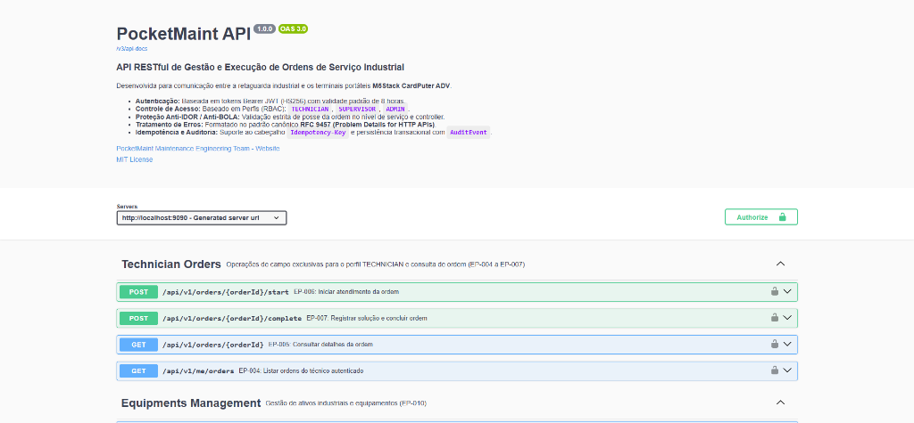
  &nbsp;
  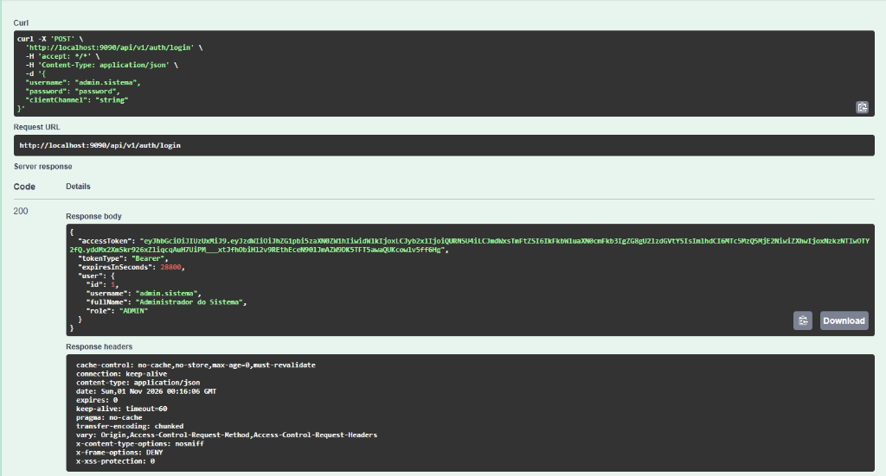
</p>
<p align="center">
  <em>Swagger UI (OpenAPI 3.0): Catálogo operacional com autenticação Bearer JWT (esquerda) e teste transacional com retorno 200 OK e token emitido (direita).</em>
</p>

### Como autenticar no Swagger UI:
1. Acesse o endpoint **`POST /api/v1/auth/login`**.
2. Execute a requisição com o usuário desejado (ex.: `tec.carlos` ou `admin.sistema` com a senha `password`).
3. Copie o valor do campo `accessToken` da resposta JSON.
4. Clique no botão **Authorize** (ícone de cadeado verde no topo direito do Swagger UI).
5. Cole o token no campo de valor e clique em **Authorize**. Todas as requisições subsequentes incluirão o cabeçalho `Authorization: Bearer <token>`.

---

## 9. Catálogo Canônico de Endpoints da API

| Código | Método | Rota | Perfis Permitidos | Descrição |
| :---: | :---: | :--- | :---: | :--- |
| **EP-001** | `GET` | `/api/v1/health` | Público | Verificação de disponibilidade e horário do servidor. |
| **EP-002** | `POST` | `/api/v1/auth/login` | Público | Autentica credenciais e emite token Bearer JWT (8h). |
| **EP-003** | `GET` | `/api/v1/auth/me` | Autenticado | Identificação dos dados da sessão ativa. |
| **EP-004** | `GET` | `/api/v1/me/orders` | `TECHNICIAN` | Lista compacta e paginada das ordens do técnico logado. |
| **EP-005** | `GET` | `/api/v1/orders/{id}` | `TECHNICIAN`*, `SUPERVISOR`, `ADMIN` | Consulta detalhada da OS (*se técnico, apenas as suas). |
| **EP-006** | `POST` | `/api/v1/orders/{id}/start` | `TECHNICIAN`* | Inicia atendimento presencial (`ASSIGNED` $\rightarrow$ `IN_PROGRESS`). |
| **EP-007** | `POST` | `/api/v1/orders/{id}/complete` | `TECHNICIAN`* | Registra solução e conclui OS (`IN_PROGRESS` $\rightarrow$ `COMPLETED`). |
| **EP-008** | `POST` | `/api/v1/orders` | `SUPERVISOR`, `ADMIN` | Abertura de nova OS vinculada a equipamento ativo. |
| **EP-009** | `POST` | `/api/v1/orders/{id}/assign` | `SUPERVISOR`, `ADMIN` | Designação ou reatribuição de técnico responsável. |
| **EP-010** | `POST` | `/api/v1/orders/{id}/cancel` | `SUPERVISOR`, `ADMIN` | Cancelamento de OS com justificativa obrigatória. |
| **EP-010** | `GET` | `/api/v1/orders/{id}/audit` | `SUPERVISOR`, `ADMIN` | Trilha cronológica imutável de eventos de auditoria. |
| **Ativos** | `POST/PUT/DELETE` | `/api/v1/sectors/**` | `ADMIN` | Gestão de setores com inativação lógica. |
| **Ativos** | `POST/PUT/DELETE` | `/api/v1/equipments/**` | `ADMIN` | Gestão de equipamentos com inativação lógica. |

---

## 10. Padronização de Erros (RFC 9457)

Qualquer falha de requisição ou violação de regra de negócio devolve respostas uniformes no padrão canônico RFC 9457:

```json
{
  "timestamp": "2026-10-31T16:20:00Z",
  "status": 403,
  "errorCode": "ACCESS_DENIED_NOT_OWNER",
  "title": "Acesso negado ao recurso",
  "userMessage": "Esta ordem de serviço não está atribuída ao seu usuário.",
  "path": "/api/v1/orders/10",
  "fieldErrors": []
}
```

### Principais Códigos de Máquina (`errorCode`):
* `AUTH_TOKEN_EXPIRED`: Token JWT vencido (HTTP 401), orienta o CardPuter a reautenticar.
* `AUTH_REQUIRED`: Token JWT ausente, malformado ou credenciais inválidas (HTTP 401).
* `ACCESS_DENIED_NOT_OWNER`: Violação de barreira Anti-IDOR/BOLA (HTTP 403).
* `ACCESS_DENIED_INSUFFICIENT_ROLE`: Tentativa de acesso sem papel exigido (HTTP 403).
* `INVALID_ORDER_STATE_TRANSITION`: Tentativa de transição proibida na máquina de estados (HTTP 409).
* `RESOURCE_NOT_FOUND`: Entidade não encontrada por ID (HTTP 404).
* `VALIDATION_FAILED`: Parâmetros ou campos de entrada fora do contrato (HTTP 422).

---

## 11. Museu & Galeria de Evolução de Hardware (Bancada Real)

Esta galeria documenta a evolução fotográfica real do firmware executando diretamente no **M5Stack CardPuter ADV** durante o ciclo de desenvolvimento:

| Marco / Etapa | Tela no CardPuter | Registro Fotográfico em Bancada |
| :--- | :--- | :---: |
| **Milestone 7**<br>*(Bring-up de Hardware)* | **VAL-01: Diagnóstico Inicial**<br>Primeira inicialização do display ST7789V2, validação de leitura da bateria e teste de resposta das 56 teclas físicas. | 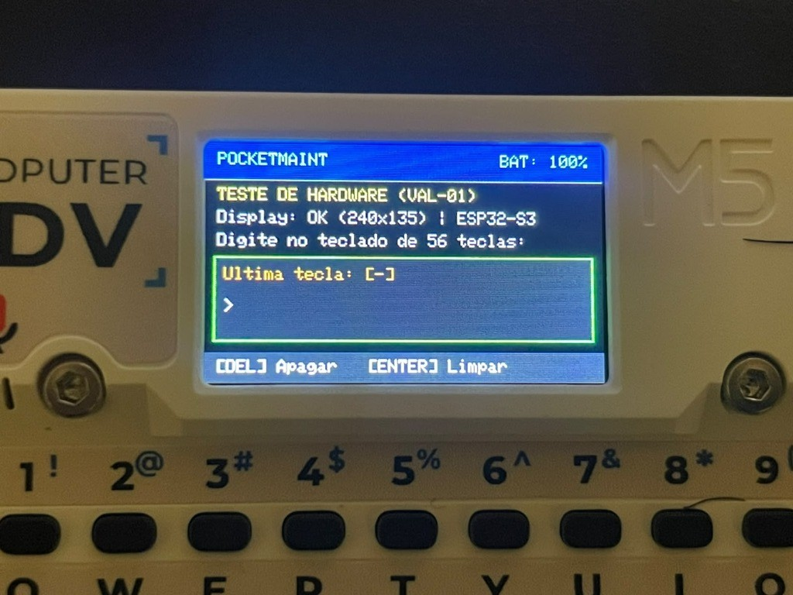 |
| **Milestone 8**<br>*(Infraestrutura & Rede)* | **SCR-002: Associação Wi-Fi 2.4 GHz**<br>Conexão com roteador local, medição de sinal (RSSI) e alocação de sessão volátil em RAM. | 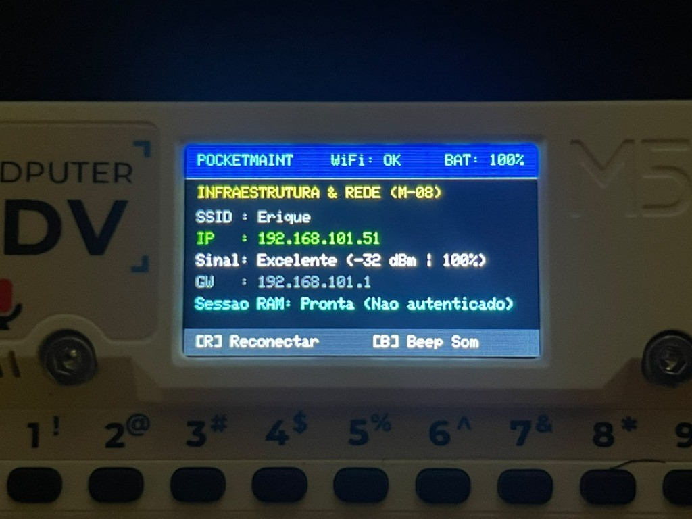 |
| **Milestone 9**<br>*(Interface de Usuário)* | **SCR-002: Diagnóstico de Conexão**<br>Exibição de IP local, força de sinal excelente (-32 dBm) e prontidão de link para login. | 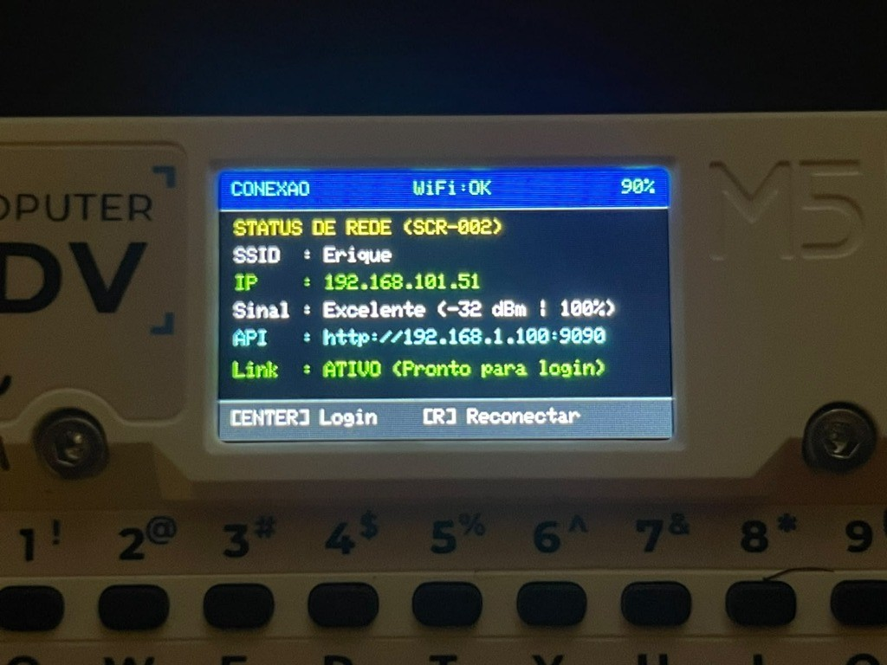 |
| **Milestone 9**<br>*(Interface de Usuário)* | **SCR-003: Autenticação Segura**<br>Formulário de credenciais do técnico com máscara de asteriscos (`*`) e navegação de campos. | 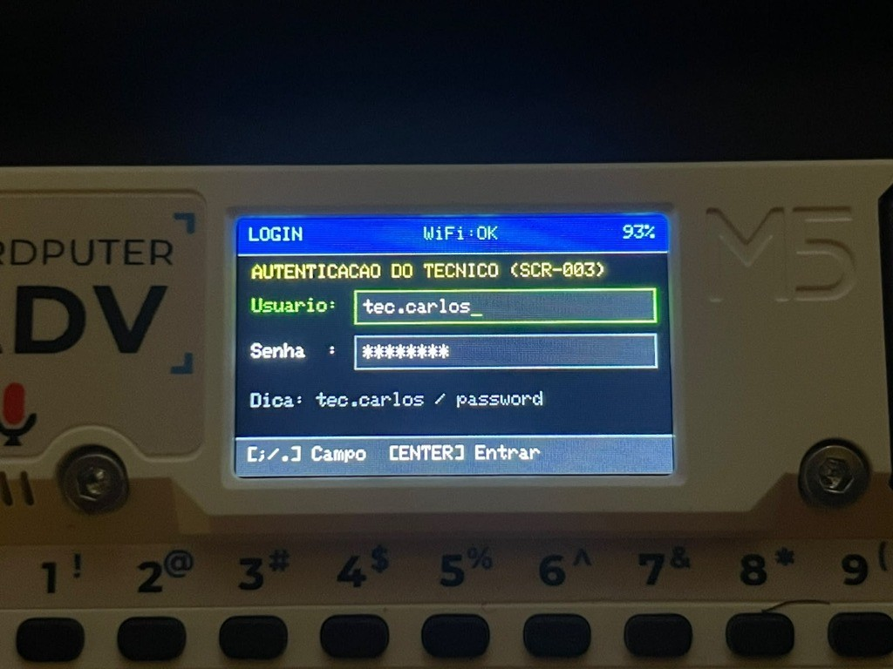 |
| **Milestone 9**<br>*(Interface de Usuário)* | **SCR-004: Fila de Ordens Atribuídas**<br>Lista com cursor direcional (`>`), tags de status (`ASSIGNED`, `IN_PROGRESS`) e nível de criticidade. |  |
| **Milestone 9**<br>*(Interface de Usuário)* | **SCR-005: Detalhes da Ordem de Serviço**<br>Visualização de equipamento, setor, defeito com rolagem vertical e atalho (`[I] Iniciar OS`). |  |
| **Milestone 10**<br>*(Formulários & Ações)* | **SCR-006: Confirmação de Início de OS**<br>Diálogo de confirmação prévia com exibição de código da OS e equipamento antes de alterar o estado. | 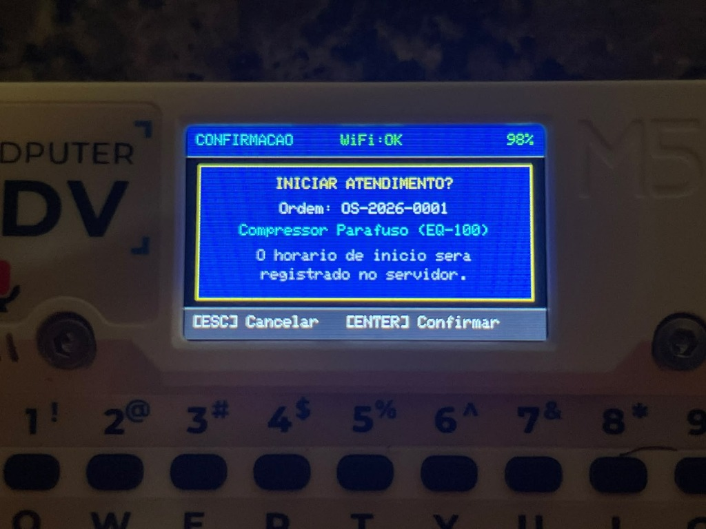 |
| **Milestone 10**<br>*(Formulários & Ações)* | **SCR-009: Feedback de Início de Atendimento**<br>Faixa verde com confirmação do servidor alterando o status da OS para `IN_PROGRESS`. | 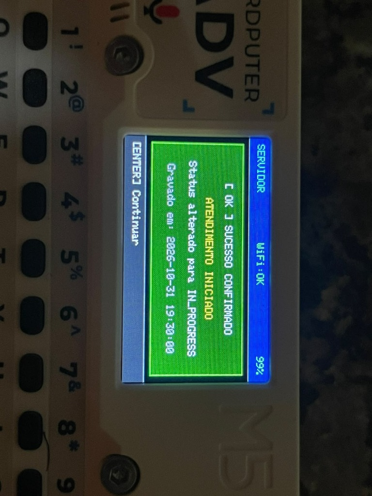 |
| **Milestone 10**<br>*(Formulários & Ações)* | **SCR-005: Ordem em Andamento**<br>Visualização de detalhes atualizada dinamicamente com status `IN_PROGRESS` e atalho `[C] Concluir`. | 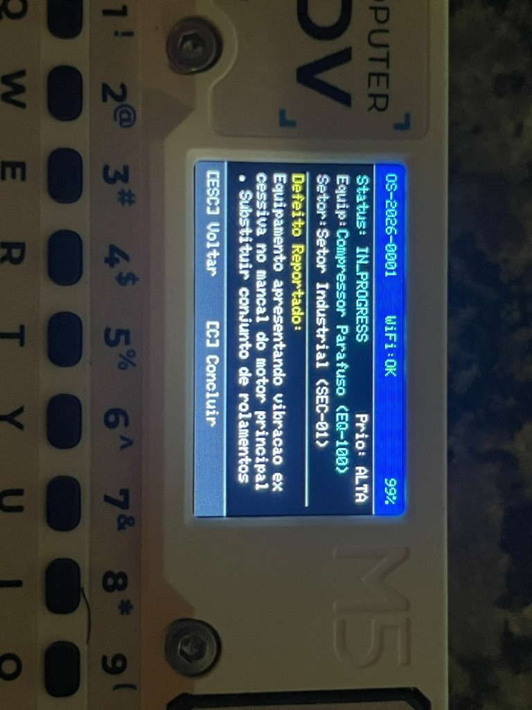 |
| **Milestone 10**<br>*(Formulários & Ações)* | **SCR-007: Validação de Solução (BR-005)**<br>Validação de regra de negócio em tempo real exigindo no mínimo 10 caracteres na descrição da solução técnica. | 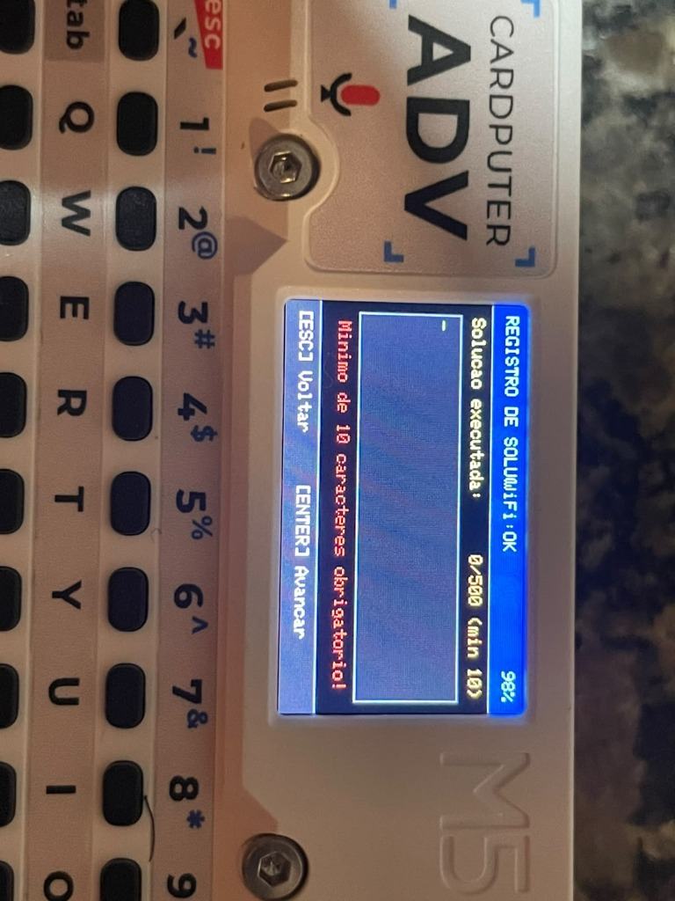 |
| **Milestone 10**<br>*(Formulários & Ações)* | **SCR-007: Buffer de Teclado e Contador**<br>Digitação contínua via teclado físico de 56 teclas com contador dinâmico de caracteres (`X/500`) e borda verde. | 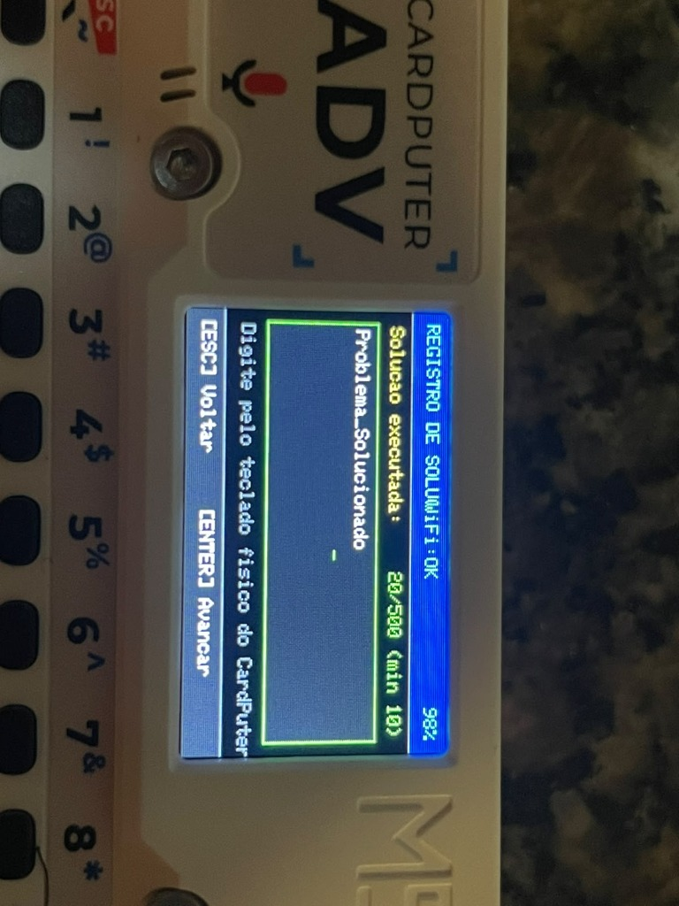 |
| **Milestone 10**<br>*(Formulários & Ações)* | **SCR-008: Confirmação Prévia de Conclusão**<br>Tela de guarda e confirmação com resumo da solução digitada antes do disparo ao servidor. | 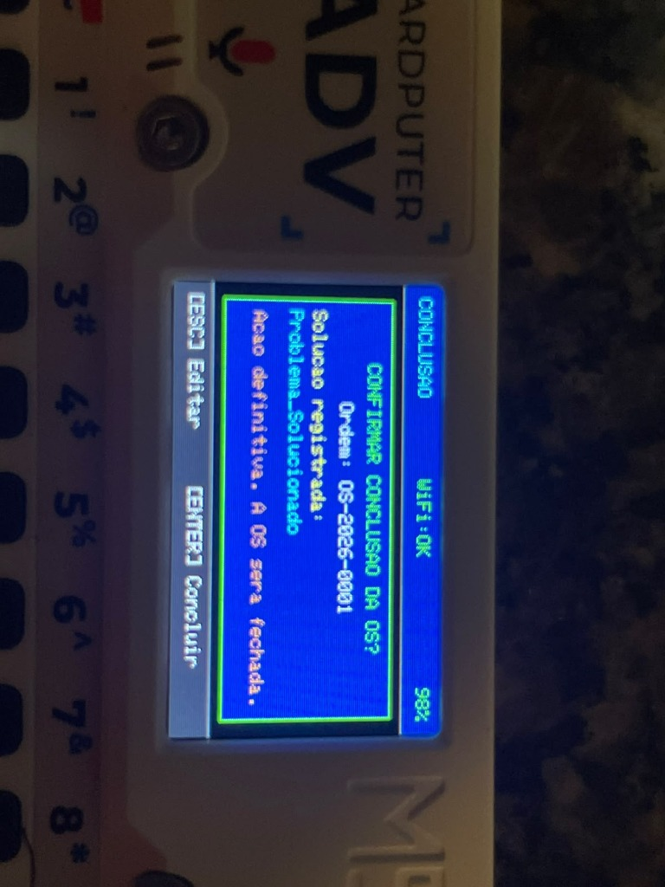 |
| **Milestone 10**<br>*(Formulários & Ações)* | **SCR-009: Feedback Transacional de Sucesso**<br>Faixa verde com retorno de status `COMPLETED` confirmado com carimbo de data/hora do servidor. | 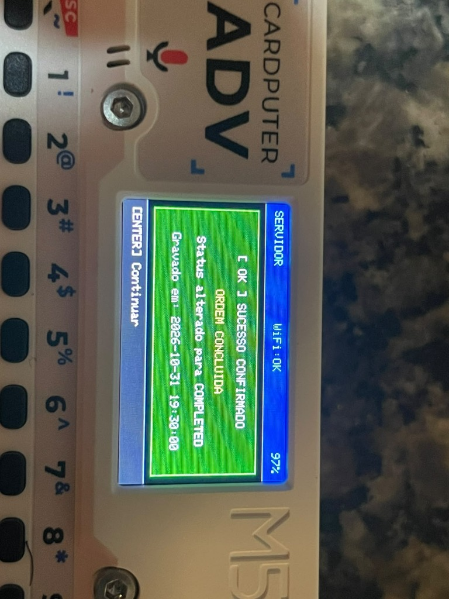 |
| **Milestone 11**<br>*(Integração REST)* | **SCR-002: Diagnóstico de Conexão e API**<br>Validação de conectividade com a API Spring Boot em `192.168.101.17:9090` e atalho de verificação de saúde (`[H] Health`). | 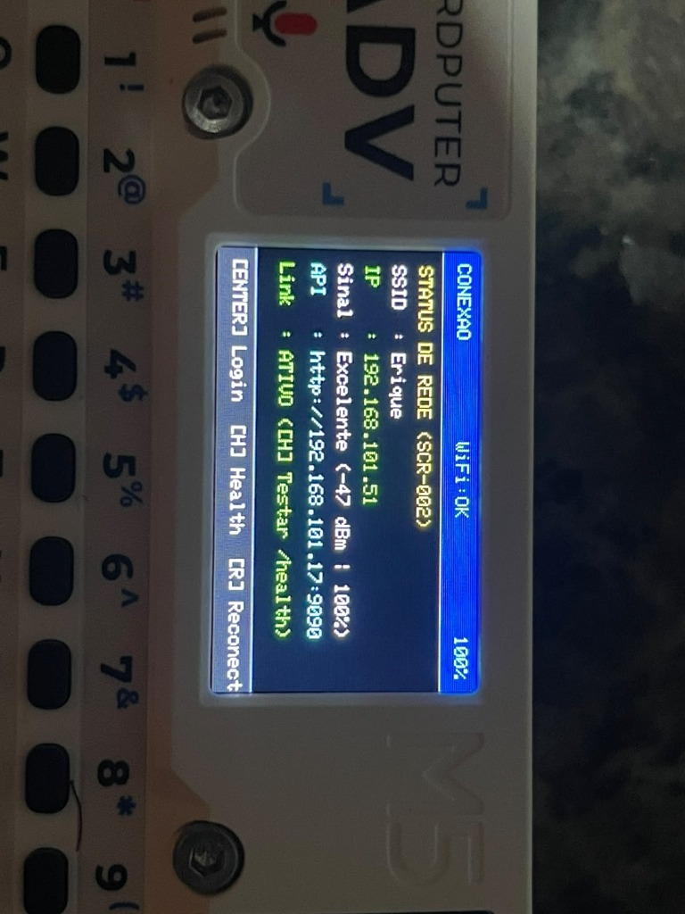 |
| **Milestone 11**<br>*(Integração REST)* | **SCR-009: Autenticação Real 200 OK**<br>Recepção do Bearer Token JWT real emitido pelo backend Spring Boot, gravação em RAM e identificação do técnico (`Carlos Mendes`). | 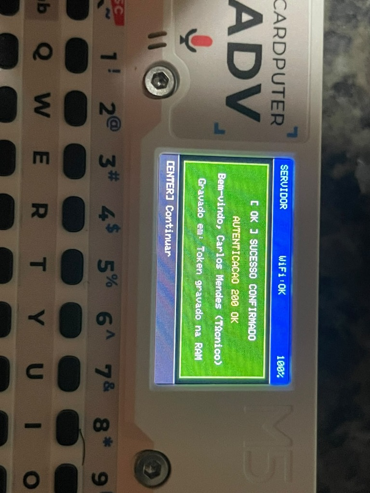 |
| **Milestone 12**<br>*(Ciclo de Campo)* | **SCR-004: Fila Real de Ordens (API)**<br>Consulta real ao endpoint `/api/v1/me/orders` exibindo estado de fila sem ordens atribuídas e atalhos de atualização (`[R] Recarregar`). | 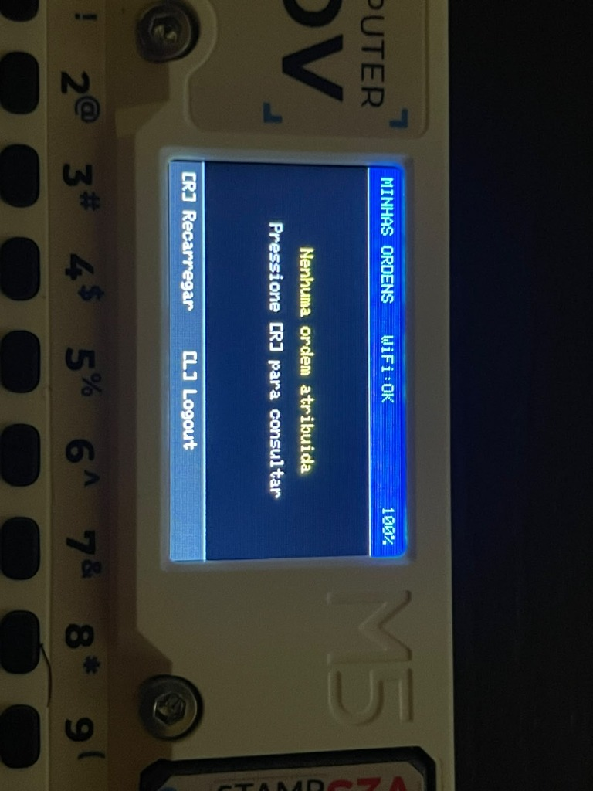 |

